# QtWidgetsApplication

平时练手的 Qt 小功能控件合集，包含 **35 个独立示例工程**，涵盖自定义控件、窗口交互、绘制动画、聊天界面、轮播与滚动等内容，适合学习 Qt Widgets 和参考控件实现。

每个示例都有独立的 `main.cpp`，可以在 Visual Studio 解决方案中选择需要的项目运行。下方保留了原有的 **30 张 GIF 效果图**，并补充了功能索引、构建说明和组件复用入口。

[功能索引](#功能索引) · [构建与运行](#构建与运行) · [效果展示](#效果展示) · [组件复用与目录说明](#组件复用与目录说明) · [许可证](#许可证)

## 功能索引

### 基础控件、输入与验证

| 示例源码 | 主要功能 | 预览 |
| --- | --- | --- |
| [ColorPicker](ColorPicker/) | 自绘 SV 色板、色相与透明度调节，HEX/RGBA 联动、颜色复制与最近颜色 | [效果](#colorpicker) |
| [ButtonBase](ButtonBase/) | 三种自绘开关按钮，支持指示器滑动动画与颜色配置 | [说明](#buttonbase) |
| [LineEdit](LineEdit/) | 输入校验、长度限制、输入法开关、密码显示和账号补全 | [效果](#lineedit) |
| [ComboBox](ComboBox/) | 可编辑账号下拉框，自定义头像、昵称、选择及删除交互 | [效果](#combobox) |
| [rollingBox](rollingBox/) | 年月日滚动选择、月份天数联动、年龄与星座显示，以及横向数值滚动 | [效果](#rollingbox) |
| [Verification](Verification/) | 四位字母数字图形验证码、干扰点、双击刷新及本地输入比较 | [效果](#verification) |
| [slidepuzzlewidget](slidepuzzlewidget/) | 滑块拼图、缺口重合判断、结果提示与背景切换 | [效果](#slidepuzzlewidget) |

### 窗口与桌面交互

| 示例源码 | 主要功能 | 预览 |
| --- | --- | --- |
| [frameLessScale](frameLessScale/) | 无边框窗口拖动、八方向缩放与 QSplitter 布局 | [效果](#framelessscale) |
| [DockWin](DockWin/) | QDockWidget 面板停靠、浮动拆分与标签合并 | [效果](#dockwin) |
| [floatingWin](floatingWin/) | 无边框窗口拖动、贴近屏幕上边缘后的自动隐藏与展开 | [效果](#floatingwin) |
| [moveWidget](moveWidget/) | 子控件在父窗口内自动横向移动、触边后反向 | [效果](#movewidget) |
| [DragObject](DragObject/) | 为 QWidget 添加鼠标拖动，支持左键及父容器范围限制 | [效果](#dragobject) |
| [SysteamTrayTest](SysteamTrayTest/) | 系统托盘、菜单、图标闪烁、双击显示窗口，以及退出或隐藏选项记忆 | [效果](#systeamtraytest) |
| [notify](notify/) | 应用自绘桌面通知队列，同屏数量控制、排队补位与淡入淡出 | [效果](#notify) |
| [Clock](Clock/) | 中文环形时钟，显示系统日期时间，每秒刷新 | [效果](#clock) |

### 聊天与个人资料

| 示例源码 | 主要功能 | 预览 |
| --- | --- | --- |
| [chatMessageWidget](chatMessageWidget/) | 多会话切换、头像、左右消息气泡、时间分隔和本地消息回显 | [效果](#chatmessagewidget) |
| [chatBubbe](chatBubbe/) | 利用 QTextBrowser、图片与 QSS 展示聊天气泡样式 | [说明](#chatbubbe) |
| [changeUserInfo](changeUserInfo/) | 个人资料编辑界面，包含生日、情感状态、游戏偏好及本地图片选择 | [效果](#changeuserinfo) |

### 绘制、动画与视觉效果

| 示例源码 | 主要功能 | 预览 |
| --- | --- | --- |
| [paintEvent](paintEvent/) | QPainter 绘制实验，默认展示动画描边与换行文字 | [效果](#paintevent) |
| [clickedAnimation](clickedAnimation/) | 点击水波、图标位移与摆动动画 | [效果](#clickedanimation) |
| [animation](animation/) | 属性动画、透明度、旋转、阴影、路径关键帧与连击展示 | [效果](#animation) |
| [GraphicsEffect](GraphicsEffect/) | 滑块调节模糊、透明度、着色强度与阴影模糊半径 | [效果](#graphicseffect) |
| [progress](progress/) | 线形、圆形、水波、电池、PK 等多种进度条外观 | [效果](#progress) |
| [Lrc](Lrc/) | 透明无边框窗口中的歌词文字渐变高亮 | [效果](#lrc) |

### 轮播、展示与滚动

| 示例源码 | 主要功能 | 预览 |
| --- | --- | --- |
| [marqueeLabel](marqueeLabel/) | 自绘富文本跑马灯，文字水平循环移动 | [效果](#marqueelabel) |
| [carouselLabel](carouselLabel/) | 带说明文字的图片轮播，支持自动与按钮切换 | [效果](#carousellabel) |
| [banner](banner/) | Banner 自动轮播、左右切换与悬停显示按钮 | [效果](#banner) |
| [suspensionSlide](suspensionSlide/) | 覆盖在内容上的横纵滚动条，包含滚动区域和列表封装 | [效果](#suspensionslide) |
| [SmoothScrollBarTest](SmoothScrollBarTest/) | 使用缓动动画实现纵向滚轮平滑滚动 | [效果](#smoothscrollbartest) |
| [NodeEditor](NodeEditor/) | 节点拖动、多选、端口连线、画布缩放平移，以及 JSON 保存加载 | [效果](#nodeeditor) |
| [ImageCropper](ImageCropper/) | 图片缩放平移、八方向裁剪框、固定比例与圆形预览，以及原图像素导出 | [效果](#imagecropper) |
| [GalleryWidget](GalleryWidget/) | 图片卡片长廊，自动分列、动画重排、悬停缩放与点击水波 | [效果](#gallerywidget) |
| [IconPanel](IconPanel/) | 四组内置图标字体的网格面板、码点提示与悬停样式 | [效果](#iconpanel) |

### 语言处理与网页交互

| 示例源码 | 主要功能 | 预览 |
| --- | --- | --- |
| [pinyin](pinyin/) | 提取首字符及整段文本的拼音首字母，处理英文字母和数字 | [效果](#pinyin) |
| [JsWithCpp](JsWithCpp/) | Qt WebEngine 嵌入本地网页，通过 QWebChannel 双向传递文本 | [效果](#jswithcpp) |

聊天、个人资料和验证码示例主要展示本地界面与交互：聊天消息由本地回显产生，资料页尚未实现保存和服务端上传，验证码与滑块结果也在本地计算。

## 构建与运行

### 工程环境

以下根据已提交的工程文件整理，**本次文档更新未执行构建或运行验证**。

| 项目 | 当前工程配置 |
| --- | --- |
| 主要平台 | Windows；部分示例直接调用 Win32 API |
| 解决方案 | [QtWidgetsApplication.sln](QtWidgetsApplication.sln)，由 Visual Studio 2022 / 17.6 保存 |
| C++ 工具集 | `v143`，需安装 Visual Studio 的“使用 C++ 的桌面开发”组件 |
| Qt | 工程登记的安装项名称为 `Qt5.12.11_msvc2017_32`，对应 Qt 5.12.11 MSVC 2017 32 位套件 |
| Qt 工程集成 | Qt VS Tools / Qt MSBuild，用于处理 MOC、UIC、RCC 等构建步骤 |
| 基础 Qt 模块 | Core、Gui、Widgets |
| 网页示例模块 | `JsWithCpp` 还使用 Network、WebEngine、WebEngineWidgets、WebChannel |
| 建议起始配置 | 解决方案选择 `Debug / x86`，项目平台对应 `Win32` |
| Windows SDK | 不同项目与配置记录了 `10.0`、`10.0.17763.0`、`10.0.19041.0`；`10.0` 自动选择本机已安装的最新 SDK，固定版本需安装或重定向 |

Qt 安装项名称中的 `msvc2017` 与工程的 `v143` 是两个不同的配置字段，配置本机环境时需要分别核对。解决方案虽提供 x64 选项，但部分项目映射到 Win32，部分 x64 配置仍引用上述 32 位 Qt 套件，使用 64 位构建前需要先整理对应配置。

### 使用 Visual Studio

1. 克隆仓库：

   ```bash
   git clone https://github.com/KikyoShaw/QtWidgetsApplication.git
   ```

2. 安装 Visual Studio 2022 的 C++ 桌面开发组件、v143 工具集、所需 Windows SDK，以及 Qt VS Tools。
3. 安装对应 Qt 套件，在 Qt VS Tools 的 Qt Versions 中注册 `Qt5.12.11_msvc2017_32`；也可在项目的 Qt 设置中选择本机正确的同架构安装项。运行 `JsWithCpp` 时需要同时具备 WebEngine 和 WebChannel 组件。
4. 打开根目录 [QtWidgetsApplication.sln](QtWidgetsApplication.sln)，选择 `Debug / x86`。
5. 在解决方案资源管理器中，右键需要体验的示例，设为启动项目，生成并运行该项目。各示例是独立程序，可以先只生成目标项目。
6. 如果提示 Windows SDK 版本缺失，安装目标版本，或将该项目重定向到本机已安装的合适 SDK；如果找不到 `Qt.props`、`qt.targets`，检查 Qt VS Tools / Qt MSBuild 的配置。

### 工作目录与交互说明

| 示例 | 运行时说明 |
| --- | --- |
| `JsWithCpp` | 当前代码会先检查或复制 `<工作目录>/qrc/qwebchannel.js`，失败便提前结束页面加载。调试时可将工作目录设为 `$(ProjectDir)`，使用仓库内已有的 `qrc` 目录。网页本身通过 Qt 资源加载。 |
| `changeUserInfo` | 游戏列表数据从工作目录下的 `qrc` 文件读取，调试工作目录应设为该示例目录，例如 `$(ProjectDir)`。 |
| `chatMessageWidget` | 启动后先显示测试窗口，点击 `test` 按钮逐个打开预置联系人会话。 |
| `Clock` | 启动后全屏显示，按 `Esc` 退出。 |
| `SysteamTrayTest` | 点击示例界面的关闭按钮时，按本地选项退出、隐藏到托盘或弹出选择框；偏好保存在工作目录的 `common.ini`，也可通过托盘菜单退出。 |

### 使用 Qt Creator

[slidepuzzlewidget/slidepuzzlewidget.pro](slidepuzzlewidget/slidepuzzlewidget.pro) 提供了独立 qmake 工程，可以用 Qt Creator 打开并选择匹配的 Qt Kit。

仓库目前没有统一的 CMake 或顶层 qmake 工程。其他示例主要提供 Visual Studio 工程；滑块示例中的 Qt 6 兼容配置也不代表全部示例已完成 Qt 6 适配。

## 效果展示

以下保留原有全部 GIF，图片与示例的对应关系不变。

### rollingBox

年月日滚动选择控件，随年月调整日期范围，并显示年龄和星座；另含横向数值滚动示例。

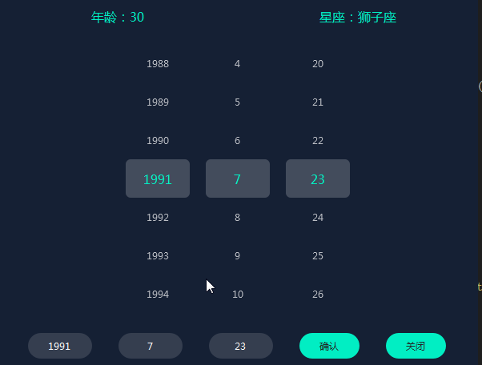

### frameLessScale

无边框窗口的拖动、四边及四角缩放，并演示内部 QSplitter 布局。默认入口使用 `FramelessWidget`。

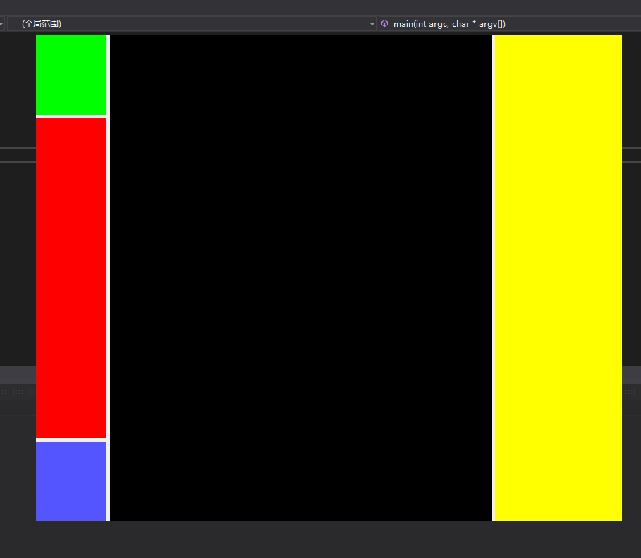

### marqueeLabel

通过自绘和定时器实现水平移动的富文本跑马灯，文字移出左侧后循环进入。

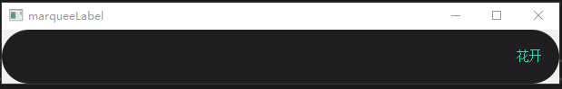

### carouselLabel

带说明文字的图片轮播控件，支持自动轮播和按钮切换。


### DockWin

使用两个 QDockWidget 承载日历和文本编辑器，演示面板停靠、浮动拆出和标签合并。

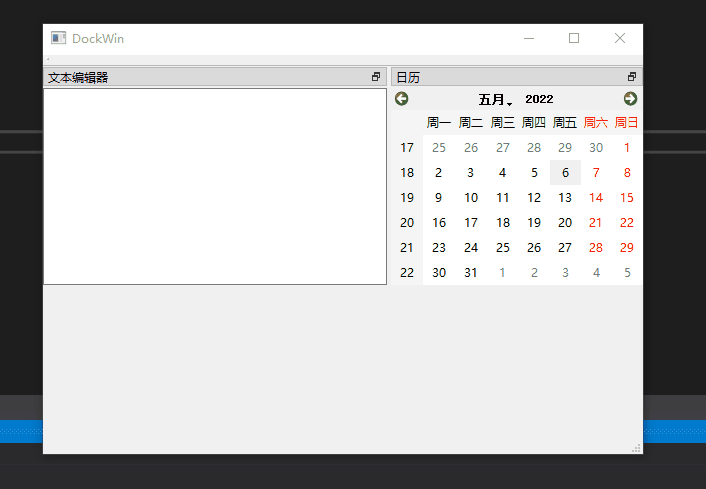

### chatMessageWidget

仿 QQ 聊天界面，包含多会话切换、头像、左右气泡、时间分隔和消息尺寸调整。发送时会将同一文本分别作为自己和对方的消息显示。

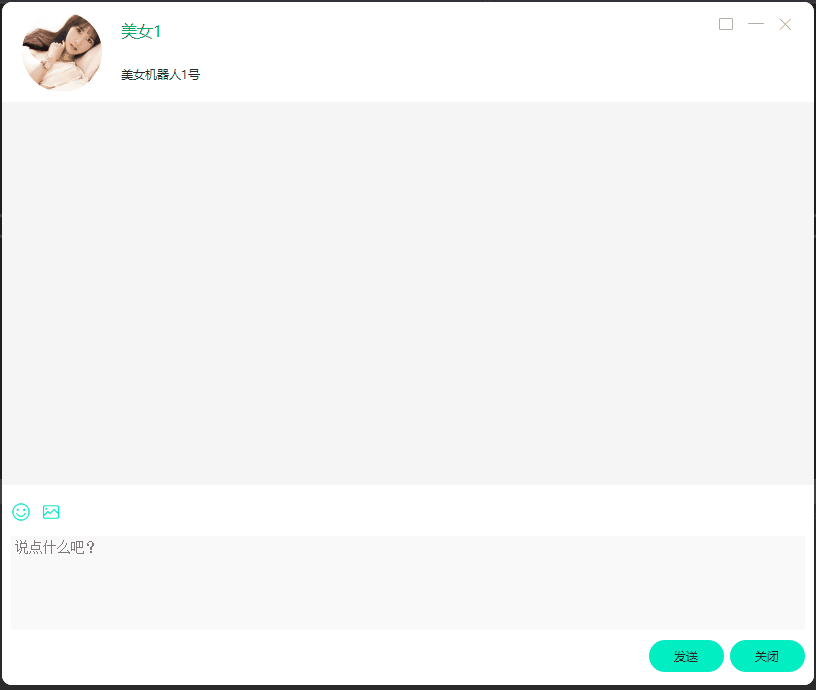

### floatingWin

窗口拖到屏幕上边缘后，鼠标离开时自动隐藏，移入残留边缘时展开。当前实现处理上边缘，并使用 Windows API 设置置顶状态。

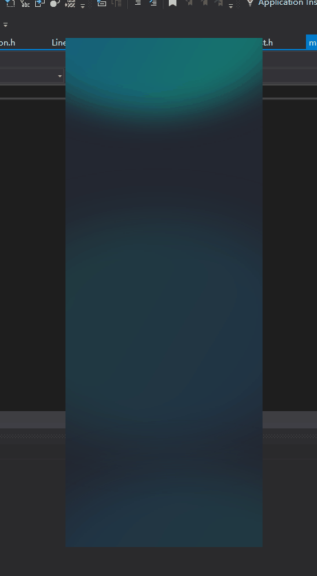

### moveWidget

点击按钮后，子控件在父窗口内自动横向移动，触及左右边界时反向。

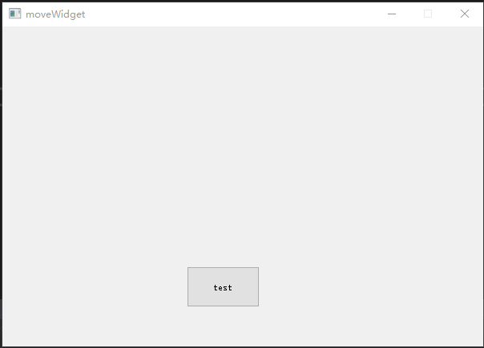

### LineEdit

QLineEdit 用法合集，演示输入校验、长度设置、输入法开关、密码回显和预置账号补全。

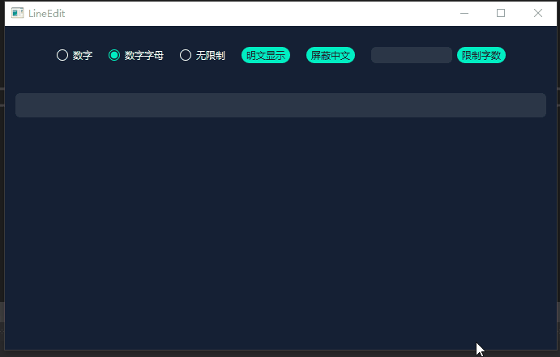

### JsWithCpp

在 Qt WebEngine 中嵌入本地网页，通过 QWebChannel 在 JavaScript 和 C++ 之间双向发送文本。

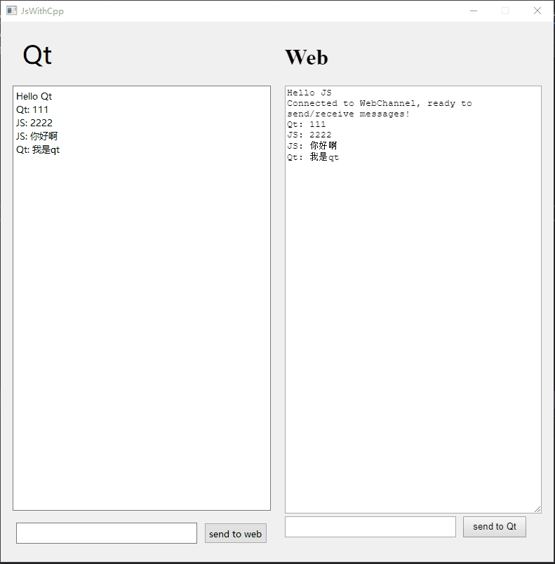

### paintEvent

QPainter 绘制实验，当前默认展示动画描边与换行文字。其他绘制方法保留在源码中，可通过修改调用切换。

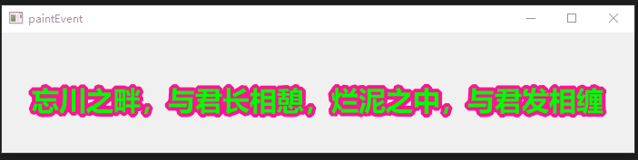

### clickedAnimation

演示鼠标点击水波、图标循环位移与摆动等动画效果。

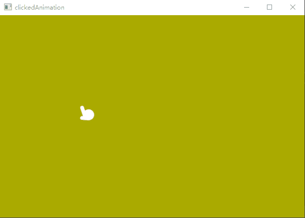

### SysteamTrayTest

系统托盘功能示例，包含图标、提示文字、右键菜单、双击显示窗口和图标闪烁；点击界面的关闭按钮时，可选择退出或隐藏到托盘，并记住选项。


### DragObject

通过事件过滤器为 QWidget 添加鼠标拖动，示例覆盖普通容器、按钮、进度条和 LCD 控件，可限制鼠标左键及父容器边界。

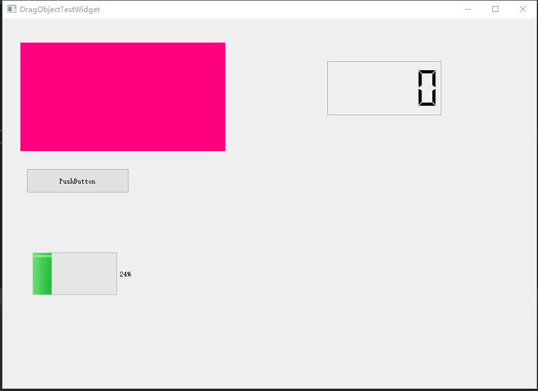

### progress

多种进度条外观示例，包括线形、圆形、水波、电池和 PK 等样式，通过同一滑块调节进度。

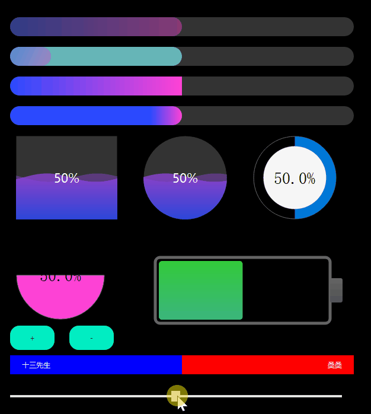

### changeUserInfo

仿 QQ 个人资料编辑界面，包含昵称、职业、生日、情感状态、签名、游戏偏好和本地图片选择。游戏最多选择三项，图片最多八张；保存和服务端上传尚未接入。

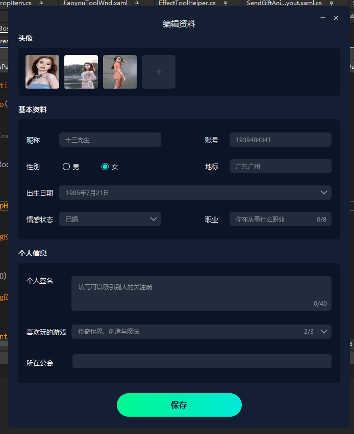

### animation

Qt 动画合集，包含位置移动、弹出、淡出、旋转、阴影、透明度、路径关键帧和连击展示。


### pinyin

根据内置映射表提取首字符的拼音首字母，以及整段文本的首字母序列。转换范围是首字母，不包含完整拼音、声调或多音字语义识别。

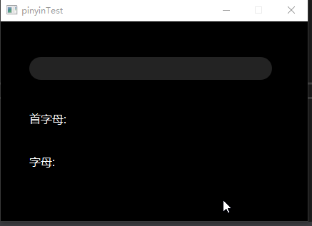

### GraphicsEffect

使用滑块分别调节图片的模糊、透明度、着色强度和阴影模糊半径。

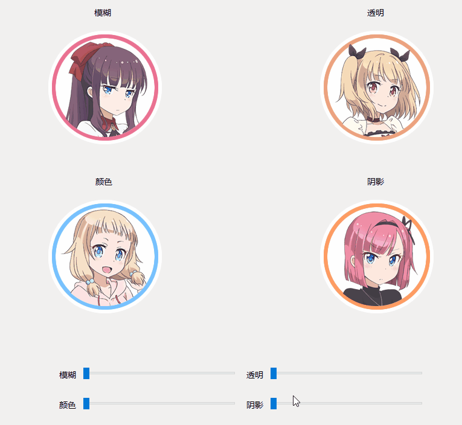

### suspensionSlide

在内容区域边缘叠放自定义横纵滚动条，并同步隐藏的原生滚动条。当前窗口展示图片滚动区域，源码另有 QListView 和 QListWidget 封装。


### Lrc

透明无边框窗口中的歌词渐变高亮效果，通过定时器扩大文字的高亮覆盖区域。当前演示使用固定文本和时长，没有接入音频播放或 LRC 文件同步。


### Clock

使用系统日期时间绘制中文环形时钟，每秒刷新，启动全屏，按 `Esc` 退出。

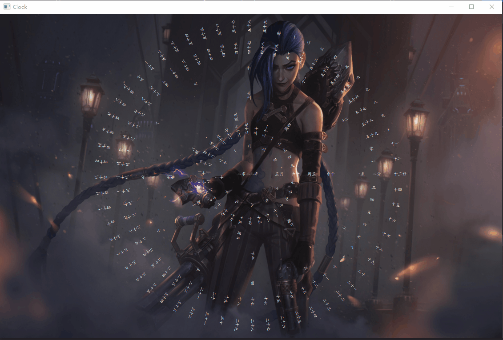

### banner

八张内置图片的 Banner 轮播，支持自动切换、左右按钮切换，以及鼠标移入时显示切换按钮。

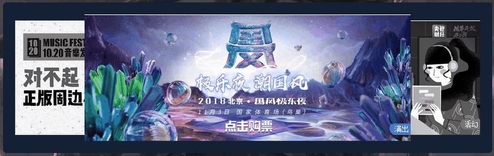

### Verification

生成四位随机字母数字验证码，绘制彩色字符和干扰点，双击刷新；确认输入时在本地忽略大小写比较。

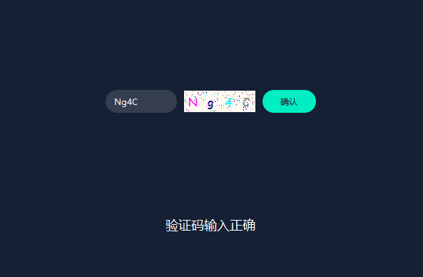

### IconPanel

四组内置图标字体的网格面板，支持面板切换、十六进制码点提示和悬停高亮。

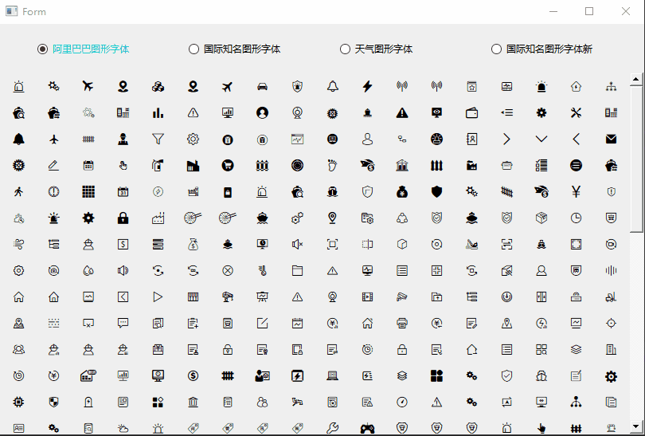

### slidepuzzlewidget

拖动水平滑块移动拼图，松开后判断拼块是否与缺口重合，显示结果并循环切换四张背景。

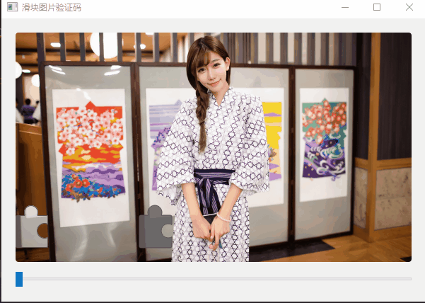

### GalleryWidget

带图片、标题与副标题的卡片长廊，随窗口宽度调整列数并动画重排，卡片具有悬停放大和点击水波反馈。


### SmoothScrollBarTest

将纵向滚轮输入转换为滚动条的属性动画，使用缓动曲线实现平滑滚动；示例内容为 100 个数字标签。

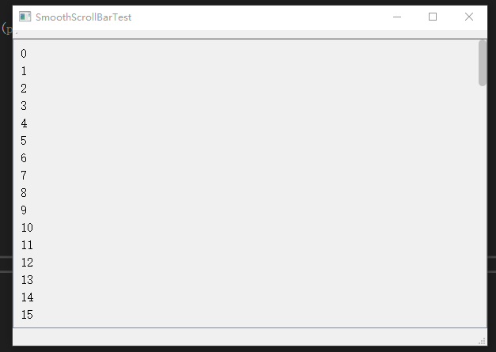

### ComboBox

自定义账号下拉框，列表展示头像、账号和昵称，支持选择回填与删除。账号数据在本地生成，用于演示外观和交互。

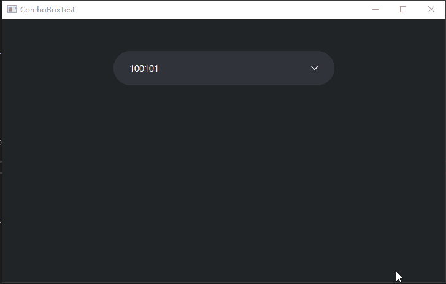

### notify

应用自绘的桌面通知队列，支持单条或批量消息、同屏数量控制、超时关闭、排队补位和待显示数量提示。


### NodeEditor

基于 QGraphicsView/QGraphicsScene 的节点编辑示例，提供输入、处理、输出三类节点，启动时显示“两输入→处理→输出”的四节点图。支持添加、拖动、框选、Ctrl 多选、双击重命名，以及删除节点和连线；节点移动时连接曲线自动跟随。

可从输入或输出端口拖动连线，最终连接方向为输出到输入。每个输入端口最多连接一条线，输出允许分支；无效方向、自连、重复或占用的连接会提示并保留现有图。滚轮围绕鼠标位置缩放，中键或空格加左键平移，提供适应内容、100% 缩放和 Esc 取消交互。

图结构支持 JSON 保存和加载，保存节点类型、标题、位置、稳定 ID 与端口连接；加载完整校验后才替换画布，失败保留当前图。此示例提供可视化图编辑，不执行节点业务算法。

在 Visual Studio 中将 `NodeEditor` 设为启动项目，选择 `Debug / x86` 后生成运行。控件仅依赖 Qt Core、Gui、Widgets，无外部图片或工作目录要求。复用入口为 [NodeEditorWidget.h](NodeEditor/NodeEditorWidget.h)。

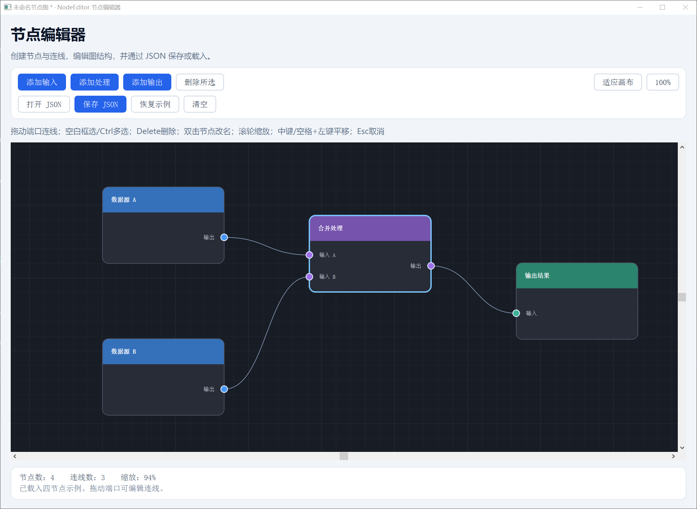

### ImageCropper

独立图片裁剪示例，支持打开或拖入本地图片，滚轮围绕鼠标位置缩放，中键或按住空格加左键平移。可移动裁剪框并通过四边与四角调整大小，提供自由比例、1:1、4:3、16:9 和圆形头像模式，配有裁剪外遮罩、三分辅助线和实时预览。

裁剪区域使用原图像素坐标，缩放和平移只改变查看方式。固定比例使用整数像素单位，图片过小时禁用无法容纳的比例。矩形结果支持 PNG 和 JPEG，JPEG 将透明区域合成白底；圆形结果保存为带透明背景的 PNG。导出通过另存操作完成，图片加载失败时保留当前内容。

在 Visual Studio 中将 `ImageCropper` 设为启动项目，选择 `Debug / x86` 后生成运行。启动时包含程序生成的示例图，无外部素材或工作目录要求。复用入口为 [ImageCropperWidget.h](ImageCropper/ImageCropperWidget.h)，提供图像设置、比例切换、原图选区、预览和裁剪结果接口。

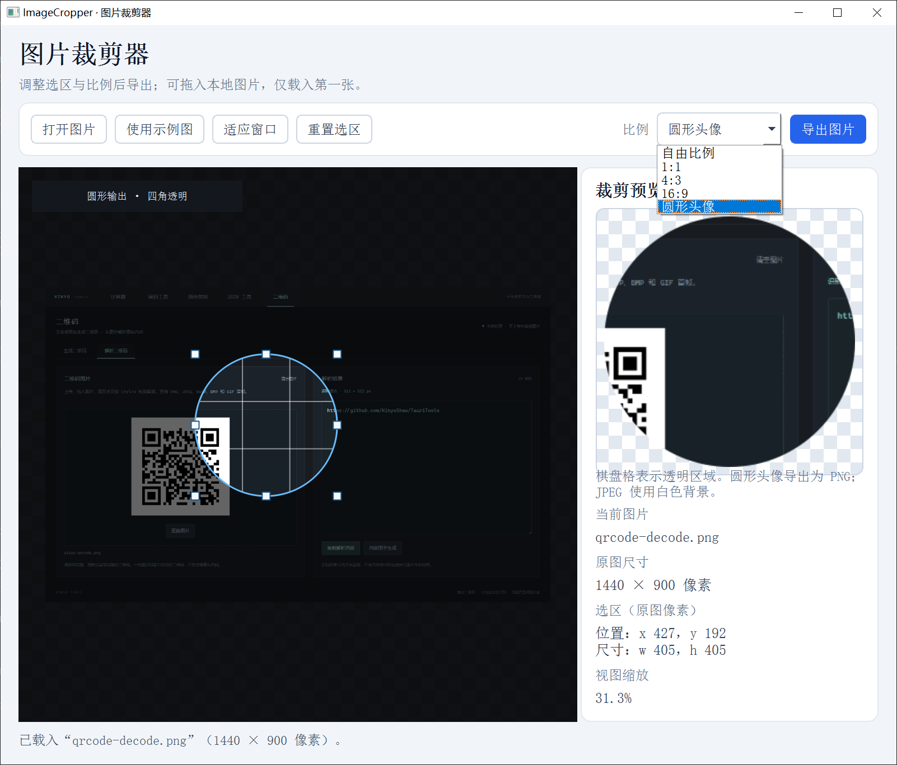

### ColorPicker

自绘取色器，提供二维饱和度/明度色板、色相条、透明度条和棋盘格颜色预览，支持鼠标拖动及方向键微调，按住 `Shift` 可加快调整。

HEX 与 RGBA 数值双向联动，HEX 格式为 `#RRGGBB` 或 `#RRGGBBAA`（透明度在末尾），提供六位和含透明度的八位复制按钮。内置预置颜色与最近 8 个颜色，最近记录仅保存在当前实例中。

在 Visual Studio 中将 `ColorPicker` 设为启动项目，选择 `Debug / x86` 后生成运行。控件仅依赖 Qt Core、Gui、Widgets，无外部图片或工作目录要求。复用入口为 [ColorPickerWidget.h](ColorPicker/ColorPickerWidget.h)。

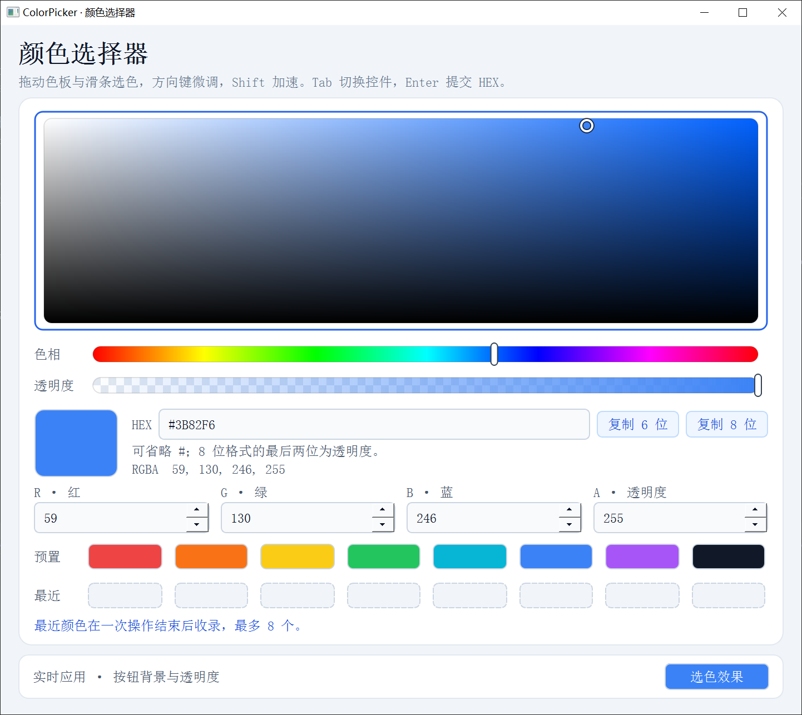

### ButtonBase

三种自绘开关按钮，基于可选中的 QToolButton，通过属性动画移动指示圆点，并提供颜色配置。当前未收录独立 GIF，可查看 [SwitchButtonBase](ButtonBase/SwitchButtonBase.h) 和 [SwitchButton](ButtonBase/SwitchButton.h) 的实现。

### chatBubbe

利用 QTextBrowser 的 QSS `border-image`、边框和内边距展示静态聊天气泡。当前未收录独立 GIF，主要样式位于 [chatBubbe.ui](chatBubbe/chatBubbe.ui)。

## 组件复用与目录说明

控件实现和演示窗口放在各自的示例目录中。复用时可先找到核心类，再连同需要的 `.h` / `.cpp`、`.ui`、`.qrc`、QSS、图片及字体资源一并接入目标工程，保留资源路径并补齐 Qt 模块依赖。

| 参考入口 | 可复用内容 |
| --- | --- |
| [NodeEditorWidget](NodeEditor/NodeEditorWidget.h) | 节点图编辑，提供 `addNode()`、`deleteSelected()`、`fitToGraph()`、`toJson()` 与 `fromJson()` |
| [ImageCropperWidget](ImageCropper/ImageCropperWidget.h) | 原图像素裁剪，提供 `setImage()`、`setAspectMode()`、`cropRect()`、`preview()` 与 `croppedImage()` |
| [ColorPickerWidget](ColorPicker/ColorPickerWidget.h) | 自绘取色器，提供 `selectedColor()`、`setSelectedColor()` 及 `colorChanged` 信号 |
| [DragObject](DragObject/DragObject.h) | 通过事件过滤器为 QWidget 增加拖动能力 |
| [SwitchButtonBase](ButtonBase/SwitchButtonBase.h)、[SwitchButton](ButtonBase/SwitchButton.h) | 开关按钮绘制及指示器动画 |
| [SmoothScrollBar](SmoothScrollBarTest/SmoothScrollBar.h) | 滚动条缓动动画与滚轮目标值处理 |
| [GalleryWidget](GalleryWidget/gallerywidget.h) | 图片卡片分列布局与位置动画 |
| [WebLobby](JsWithCpp/WebLobby.h) | Qt WebEngine 容器与 QWebChannel 桥接 |

其他目录与文件：

- [GIF/](GIF/)：README 使用的效果图。
- [QtWidgetsApplication.sln](QtWidgetsApplication.sln)：全部 35 个示例的 Visual Studio 入口。
- [sqlite/](sqlite/)：未接入解决方案的 SQLite 账号存储参考代码。当前缺少 `WADefine.h`、`vfileoperation.h` 等依赖，没有独立示例入口；复用前需要补全依赖和梳理实现。

## 许可证

仓库根目录采用 [Apache License 2.0](LICENSE)。部分源码保留了原有第三方许可声明，例如 [WebConnect.cpp](JsWithCpp/WebConnect.cpp) 中的 Qt 示例声明，复用时应一并保留。
